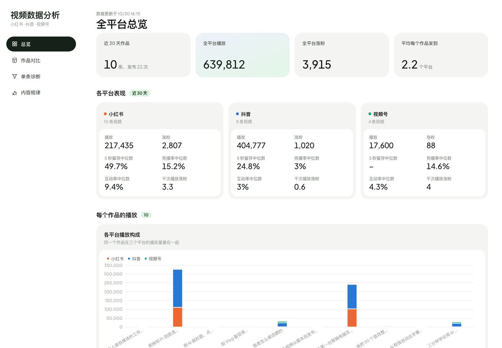
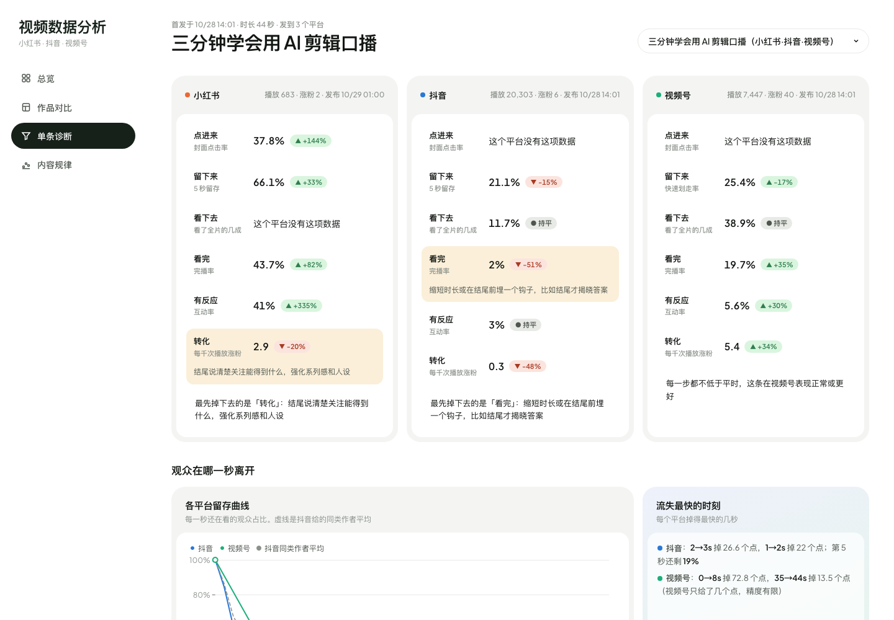

# 视频数据看板

采集小红书和抖音创作者后台的数据，并导入 TikTok、Instagram 和 X 的浏览器采集结果，存进本地数据库，生成一个看板，回答这几个问题：

- 同一作品发到多个平台，哪里表现最好？
- 观众在第几秒离开？
- 这条视频卡在哪一环：没人点、留不住、看不完，还是看完了不互动、不关注？




截图里的作品和数字都是虚构的示例数据。

看板只在你自己的电脑上运行，数据也只存在本地。不需要域名、服务器或 Vercel，除非你自己想部署到网上（可选，见[自动化流程](docs/automation.md)最后一节）。

## 一句话交给 AI 部署

如果你在用 Claude Code、Codex 这类能操作电脑的 AI 助手，把下面这段话原样发给它就行：

```text
帮我部署这个项目：https://github.com/JaelChen/video-data-dashboard
1. 把仓库下载到我的电脑上（有 git 就用 git clone，没有就下载 ZIP 并解压）。
2. 检查我有没有装 ego lite 浏览器（终端里能运行 ego-browser 命令就说明装好了）。没装的话，带我去 https://lite.ego.app/ 下载安装，并提醒我完成首次引导。
3. 检查 Python 3：Mac 用 python3，Windows 用 py。没有的话告诉我怎么装。
4. 先运行 preview.py，让我在 http://localhost:8765 看到示例看板。
5. 让我自己在 ego lite 里登录小红书创作服务平台和抖音创作者中心。你不要替我输入任何账号密码，我登录好之后会告诉你。
6. 运行 update.py 抓取我的数据。如果某个平台失败，告诉我是哪个平台、可能的原因是什么。
7. 按照 docs/automation.md 里对应我系统的那一节，设置每天自动更新。
全程只在本地运行，不要配置 config.env，也不要把任何东西部署到网上。每一步做完都告诉我结果。
```

## 它能做什么

- **国内平台自动采集**：用 [ego lite](https://lite.ego.app/) 浏览器打开你已经登录的创作者后台，读取后台页面本身加载的数据。不需要申请任何开放平台接口，也不需要把账号密码交给脚本。
- **一个作品，多次发布**：同一条视频发到多个平台会自动合成一个「作品」，可以放在一起比较。
- **和自己比**：每个指标都除以你在该平台的平均数。比如「+30%」表示比你平时高 30%，不同体量的账号也能直接看出好坏。
- **诊断漏斗**：按点进来、留下来、看下去、看完、有反应、转化这六步，标出最先掉队的那一环，并给出改进方向。
- **每秒留存曲线**：三个平台叠在一起看，抖音另外附带同类作者的平均水平做对照。
- **每天自动更新**：Mac 开机或开盖后自动运行，失败时弹通知；数据库每天备份到 iCloud。

## 快速开始

Mac 和 Windows 都能用。主要的命令差别是：Mac 上写 `python3`，Windows 上写 `py`。

| | Mac | Windows |
|---|---|---|
| 需要的软件 | [ego lite](https://lite.ego.app/)、python3（装过 Xcode 命令行工具就有） | [ego lite](https://lite.ego.app/)、[Python 3](https://www.python.org/downloads/)（安装时勾选 Add to PATH） |
| 先看示例效果 | `python3 preview.py` | `py preview.py` |
| 手动更新数据 | `python3 update.py` | `py update.py` |
| 每天自动更新 | launchd，开盖后自动补跑，失败弹通知 | 任务计划程序，错过的会补跑 |
| 自动备份 | 每天备份到 iCloud | 暂无，需手动复制 `data\videos.db` |

只想先看看效果的话，下载后运行 preview，再打开 http://localhost:8765 ，就能看到用示例数据画出的看板。

要接上自己的数据：

1. 安装 ego lite，完成首次引导。之后在终端（Windows 上用 PowerShell）里输入 `ego-browser`，应该能看到它的帮助信息。
2. 在 ego lite 里登录这三个后台：小红书创作服务平台、抖音创作者中心、视频号助手。
3. 在项目目录运行 update。它会依次采集三个国内平台并导入海外平台数据，写进 `data/videos.db`，生成 `dashboard/data.js`。
4. 再运行 preview，看到的就是你自己的数据了。

不需要安装任何第三方 Python 包。每天自动运行的设置方法分 Mac 和 Windows 两种，都写在 [自动化流程](docs/automation.md) 里。

Windows 流程作者还没有在真机上完整测试过，遇到问题欢迎提 issue。

## 文件说明

| 文件 | 作用 |
|---|---|
| `fetch.mjs`、`fetch_douyin.mjs`、`fetch_channels.mjs` | 分别采集小红书、抖音、视频号，原始数据存到 `data/raw/<账号类型>/` |
| `ingest.py` | 写进 SQLite，配对作品，计算相对表现，导出看板数据 |
| `update.py` | 一键更新：抓取、入库，可选上传到你自己的网站 |
| `preview.py` | 在本地打开看板 |
| `dashboard/index.html` | 看板页面，单文件，用 ECharts 画图 |
| `daily.sh`、`backup.sh`、`launchd.plist.template` | Mac 每天自动运行和 iCloud 备份 |
| `config.example.env` | 可选配置，比如上传地址，复制成 `config.env` 再改 |

## 延伸阅读

- [自动化流程](docs/automation.md)：每天自动跑、失败通知、iCloud 备份，以及怎么部署到自己的网站。
- [界面美化](docs/design.md)：这套看板的设计思路和配色、字体、卡片规范，也可以直接拿去给 AI 用作改界面的说明。

## 注意事项

- 这个项目通过模拟人工打开后台页面来读数据。各平台改版后，抓取脚本可能需要跟着调整。抓取频率保持每天一次就够了。
- 只读取你自己账号的数据，不发帖、不修改任何东西。
- `data/`、`config.env`、`.upload_key` 都在 `.gitignore` 里。如果你 fork 了这个仓库，不要把它们提交上去。
- 已知限制：小红书和抖音目前只抓列表的第一页（最近的作品），视频号取近 30 天。

## License

MIT


## 海外平台数据

在同级目录的 `Platform_traffic` 按其 README 启动采集服务并采集一次。本看板从该项目的 `outputs/local/collection-*.json` 导入 X、Instagram、TikTok 和 YouTube（YouTube 要等采集服务支持后才会有数据，在那之前看板上显示为空）。执行 `python3 ingest.py` 可以单独导入现有结果，执行 `python3 update.py` 同时更新国内平台。作品对比页中的缺失指标显示为「–」。

## 官方号 / 马甲号

看板顶部可以切换「官方号 / 马甲号」，两类账号的作品、粉丝趋势和「和自己比」的平均数都会分开计算。升级前已经采集的数据会自动归到官方号。

默认采集官方号。要记录马甲号：

1. 在 ego lite 里切换到马甲号登录小红书创作服务平台、抖音创作者中心和视频号助手。
2. 在 `config.env` 里设置 `ACCOUNT_TYPE="alt"`，再运行 `python3 update.py`。
3. 采集结果会写到 `data/raw/alt/`，并在看板的「马甲号」Tab 里单独展示。

切回官方号时把 `ACCOUNT_TYPE` 改回 `official` 即可，两类数据不会互相覆盖。

## 成员与单项排名

成员名单、账号主页绑定放在 `dashboard/members.json`，改完刷新页面即生效，不用重新采集。第一次用把 `dashboard/members.example.json` 复制成 `dashboard/members.json` 再填——真实名单在 `.gitignore` 里，不会跟着仓库走。

```json
{
  "weights": { "impressions": 0.5, "likes": 1, "collects": 3, "shares": 3, "comments": 1.5 },
  "members": [
    { "id": "member-a", "name": "成员 A", "accounts": [{ "platform": "xhs", "home": "https://…" }] }
  ]
}
```

- **归属规则**：账号主页是绑定主键。采集结果里带 `account_home` 且与某个成员的 `accounts[].home` 一致时才算这个人的业绩；账号名只作兜底，都对不上就记「未绑定」，不会硬塞给某个人。
- **计入范围**：只有马甲号在国内平台（小红书、抖音、视频号、B站）的发布进入排行，官方号与海外号不计入。
- **展示位置**：成员栏和「成员单项排行」只在顶部选中「马甲号」时出现；官方号使用相同看板布局，不带成员筛选，发布登记也不会提示归属成员。
- **单项排名**：分别按曝光、点赞、收藏、转发和评论累计值排序，不显示综合评分和作品得分。点击成员进入该成员的总览。
- **运营看板**：全部页面采用浅灰底、白色卡片、蓝色交互。总览与作品详情展示七项指标；没有采集到的指标显示「–」。总览曝光趋势按发布日期汇总累计值；作品详情趋势按采集快照展示，不代表每日新增。
- **待发布数**：仅统计当前账号类型、成员范围的本地发布计划，不把内置示例算作真实计划；单条作品尚未绑定发布计划时显示「–」。

## 图文跨平台对比

安装 Pillow 后，`python3 ingest.py` 会比较各平台封面图并缓存指纹。

```bash
python3 -m pip install 'Pillow>=10,<12'
```
